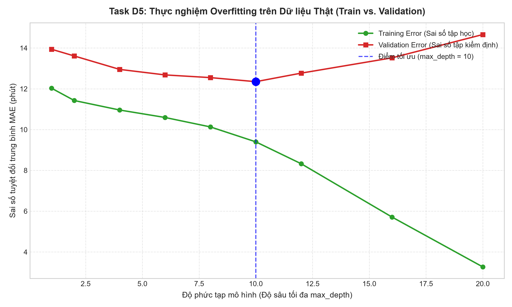

# BÁO CÁO BÀI TẬP LỚN MÔN HỌC: NHẬP MÔN KHOA HỌC DỮ LIỆU

**ĐỀ TÀI:** DỰ BÁO TRỄ CHUYẾN BAY THƯƠNG MẠI TỪ DỮ LIỆU QUAN SÁT THỰC TẾ VÀ KHÍ TƯỢNG ĐA NGUỒN

**ĐƠN VỊ:** TRƯỜNG CÔNG NGHỆ THÔNG TIN VÀ TRUYỀN THÔNG - ĐẠI HỌC BÁCH KHOA HÀ NỘI (SoICT - HUST)

**HỌC PHẦN:** IT4930 / IT4142 - NHẬP MÔN KHOA HỌC DỮ LIỆU

**NHÓM THỰC HIỆN:** NHÓM 4 THÀNH VIÊN

---

## BẢNG PHÂN CÔNG TRÁCH NHIỆM

| STT | Họ và tên | MSSV | Vai trò | Nội dung phụ trách | Mức độ hoàn thành |
|:---:|:---|:---:|:---|:---|:---:|
| 1 | [Họ và tên] | [MSSV] | Thu thập & Tích hợp dữ liệu | Nạp dữ liệu chuyến bay, tải dữ liệu thời tiết qua HTTP, viết Web Crawler (Wikipedia), Wrappers & Mediated Schema; Mục I.1 - I.2 | [..%] |
| 2 | [Họ và tên] | [MSSV] | Làm sạch & Thống kê | Xử lý khuyết/ngoại lai chỉ trên Train, thống kê mô tả đơn biến, đặc trưng chuỗi thời gian; Mục I.3 - I.4, I.6 | [..%] |
| 3 | [Họ và tên] | [MSSV] | Trực quan hóa & EDA | 11 biểu đồ EDA, PCA, K-Means; Mục I.5 và phần phát hiện ở Mục VI | [..%] |
| 4 | [Họ và tên] | [MSSV] | Mô hình & Ứng dụng | Huấn luyện, chọn tham số trên Validation, đánh giá, Web Dashboard; Mục II - III | [..%] |

---

## I. BÀI TOÁN, PHƯƠNG PHÁP VÀ TẬP DỮ LIỆU

### 1.1. Đặc tả bài toán theo bộ (T, P, E)
Trễ chuyến bay gây thiệt hại về thời gian và chi phí cho hành khách, hãng bay và sân bay. Nhóm xây dựng hệ thống dự báo trễ cất cánh cho các chuyến bay khởi hành từ 3 sân bay New York, chỉ dùng thông tin **biết được trước giờ cất cánh**.

- **T (Task):**
  - *Hồi quy:* dự báo số phút trễ cất cánh `delay_minutes` (= `dep_delay`).
  - *Phân loại:* dự báo chuyến bay có bị trễ nghiêm trọng (≥ 30 phút) hay không.
- **P (Performance):**
  - Hồi quy: MAE, RMSE, R².
  - Phân loại: Accuracy, Precision, Recall, F1, ROC-AUC, PR-AUC. Vì lớp "trễ ≥ 30 phút" chỉ chiếm khoảng 15%, F1 và ROC-AUC được dùng làm độ đo chính; Accuracy chỉ để tham khảo.
- **E (Experience):** 50.000 chuyến bay thương mại thực tế năm 2013 (16 hãng, 102 sân bay đến) kết hợp thời tiết theo giờ và quy mô sân bay đến.

### 1.2. Thu thập và tích hợp dữ liệu đa nguồn

| Nguồn | Phương pháp thu thập | Quy mô |
|---|---|---|
| **Chuyến bay** - bảng `flights` của gói nycflights13 (H. Wickham), trích từ US Bureau of Transportation Statistics | File CSV gốc; loại 8.255 chuyến bị hủy (không có `dep_delay`), lấy mẫu đều 50.000 chuyến theo thời gian (`fetch_flights.py`) | 336.776 → 50.000 chuyến |
| **Thời tiết** - bảng `weather` của nycflights13 (trạm ASOS/NOAA tại JFK, EWR, LGA) | Tải qua HTTP (`requests`) từ kho Rdatasets; đổi đơn vị sang hệ mét (`fetch_weather_api.py`) | 26.115 quan trắc (8.703 EWR, 8.706 JFK, 8.706 LGA) |
| **Quy mô sân bay đến** - Wikipedia *List of the busiest airports in the United States* (số liệu FAA) | **Web Crawler** `requests` + `BeautifulSoup`, đọc 2 bảng *Large hubs* và *Medium hubs*; lưu lại HTML gốc (`web_crawler.py`) | 65 sân bay (30 large, 35 medium) |

**Kiểm tra chất lượng khi thu thập:**

- Bản thời tiết có trong repo ban đầu chỉ có EWR (JFK 9 dòng, LGA 1 dòng), khiến khoảng 64% số chuyến không có thời tiết. Nhóm thay bằng bảng đầy đủ của bản nycflights13 hiện hành.
- Phát hiện 1 giá trị gió phi vật lý (1.687 km/h - lỗi cảm biến đã biết của bộ dữ liệu), được đặt thành giá trị khuyết.
- Gió giật trống được hiểu là "không có gió giật" và lấy bằng tốc độ gió nền.

**Tích hợp (`integrate.py`):** mỗi nguồn có một Wrapper chuẩn hóa về Mediated Schema:

| Nhóm | Thuộc tính |
|---|---|
| Chuyến bay | `flight_id`, `airline`, `tailnum`, `origin`, `dest`, `dep_timestamp`, `distance`, `delay_minutes` |
| Thời tiết tại sân bay đi | `origin_temp_c`, `origin_rain_mm`, `origin_wind_kmh`, `origin_gusts_kmh`, `origin_visibility_km`, `humid`, `pressure` |
| Quy mô sân bay đến (crawler) | `dest_hub_tier`, `dest_enplanements_m` |

- Thời tiết ghép theo khóa `(origin, year, month, day, hour)`; quy mô sân bay ghép theo `dest` (mã IATA). 89,2% số chuyến có sân bay đến thuộc nhóm large/medium hub; các sân bay còn lại nhận `dest_hub_tier = 0`.
- Khử trùng lặp theo `flight_id` (chuyến bay) và `(origin, year, month, day, hour)` (thời tiết).

### 1.3. Tiền xử lý và chống rò rỉ dữ liệu
**Phân chia trước, xử lý sau.** Dữ liệu được sắp xếp theo thời gian cất cánh và chia tuần tự (`splits.py`, dùng chung cho mọi bước):

| Tập | Số chuyến | Khoảng thời gian |
|---|:---:|---|
| Train (70%) | 35.000 | 01/01 - 13/09/2013 |
| Validation (15%) | 7.500 | 13/09 - 06/11/2013 |
| Test (15%) | 7.500 | 06/11 - 31/12/2013 |

Mọi tham số "học từ dữ liệu" chỉ được tính trên Train rồi áp dụng sang Validation/Test:

- **Giá trị khuyết:** sau tích hợp còn khoảng 240-250 dòng (0,5%) thiếu thời tiết và 5.391 dòng (10,8%) thiếu áp suất. Điền bằng median theo (sân bay, tháng) **của Train**; với tháng không có trong Train (tháng 11-12) dùng median theo sân bay của Train. Lượng mưa khuyết điền 0.
- **Loại thuộc tính gây rò rỉ:** `air_time` là thời gian bay *thực tế*, chỉ biết sau khi hạ cánh, nên bị loại khỏi dữ liệu.
- **Ngoại lai:** biên Tukey $[Q_1 - 1.5\,IQR,\ Q_3 + 1.5\,IQR]$ tính trên `y_train` là $[-32, 40]$ phút. Việc có nén `y_train` về biên này hay không được coi là một siêu tham số và chọn trên Validation. `y_val` và `y_test` **không bao giờ bị nén** (giữ nguyên các chuyến trễ tới 960 phút).
- **Chuẩn hóa:** `StandardScaler` fit trên Train (dùng cho Linear/Ridge/Lasso); Min-Max Scaling dùng cho biểu đồ tọa độ song song.

### 1.4. Thống kê mô tả đơn biến của `delay_minutes` (N = 50.000)

| Chỉ số | Giá trị | Ý nghĩa |
|:---|:---:|:---|
| Mean | 12,53 phút | Trung bình bị kéo lên bởi số ít chuyến trễ rất lâu |
| Median | −1,00 phút | Một nửa số chuyến cất cánh sớm hoặc đúng giờ |
| Mode | −5,00 phút | Giá trị phổ biến nhất là cất cánh sớm 5 phút |
| Variance / Std | 1.582,2 / 39,78 phút | Phân tán rất lớn so với trung vị |
| Skewness | +4,73 | Lệch phải mạnh |
| Kurtosis | +41,02 | Đuôi rất nặng |
| Min / Max | −30 / 960 phút | Có chuyến trễ tới 16 giờ |

Tỷ lệ chuyến đúng giờ (trễ < 15 phút) là 77,8%; tỷ lệ trễ ≥ 30 phút là 15,0%.

### 1.5. Phân tích khám phá đa biến (11 biểu đồ trong `docs/figures/`)

| # | Biểu đồ | Phát hiện chính |
|:---:|---|---|
| C1 | Run Sequence | Phần lớn chuyến dao động quanh 0, xen kẽ các đỉnh trễ đột biến rất lớn |
| C2 | Lag Plot | Trễ của chuyến bay so với trễ TB sân bay 1 giờ trước: **r = 0,362** - trễ có tính lan truyền theo giờ (tương quan) |
| C3 | Heatmap 24×7 | Trễ tăng dần trong ngày: TB 0,3 phút (trước 8h) → 5,8 (8-12h) → 10,3 (12-16h) → 20,6 (16-20h) → 56,8 phút (sau 20h) |
| C4 | Ma trận tương quan | Tương quan tuyến tính của từng biến thời tiết với trễ đều yếu (\|r\| ≤ 0,13: độ ẩm 0,129, áp suất −0,106, mưa 0,063); biến mạnh nhất là trễ TB 3 giờ trước (r = 0,456) |
| C5 | Parallel Coordinates (400 chuyến mẫu, chuẩn hóa Min-Max) | Đa số chuyến có lượng mưa bằng 0; các chuyến trễ nghiêm trọng không tách riêng theo khoảng cách, mưa hay gió giật - không biến đơn lẻ nào đủ để phân biệt, cần mô hình đa biến |
| C6 | Mùa vụ & quy mô sân bay | Tháng 6-7 (20,0 và 22,0 phút) và tháng 12 (15,9) trễ cao nhất; tháng 9-11 thấp nhất (≈ 6 phút). Chuyến đến sân bay large hub trễ TB 11,2 phút, thấp hơn medium hub (14,9) và sân bay nhỏ (16,0) |
| C7 | Histogram & KDE | Phân phối lệch phải, đỉnh quanh −5 phút |
| C8 | Boxplot theo hãng & sân bay đi | EWR trễ TB 14,82 phút, JFK 11,79, LGA 10,66 |
| C9 | Violin theo hãng | Hình dạng phân phối khác nhau rõ giữa các hãng |
| C10 | PCA 2D (7 đặc trưng số) | Hai thành phần chính giải thích 46,9% phương sai; các chuyến trễ nhiều và ít chồng lấn mạnh trên mặt phẳng PC1-PC2 |
| C11 | K-Means Elbow | Điểm gập tại k = 3 |

Trễ theo ngày trong tuần:

| Ngày | Số chuyến | Trễ TB (phút) | % trễ ≥ 30 phút |
|---|:---:|:---:|:---:|
| Thứ Hai | 7.527 | 13,99 | 16,1% |
| Thứ Ba | 7.496 | 10,95 | 14,1% |
| Thứ Tư | 7.440 | 11,75 | 14,1% |
| **Thứ Năm** | 7.405 | **16,65** | **18,5%** |
| Thứ Sáu | 7.414 | 14,66 | 17,1% |
| **Thứ Bảy** | 5.771 | **7,57** | **10,4%** |
| Chủ Nhật | 6.947 | 10,93 | 13,5% |

Theo điều kiện thời tiết tại sân bay đi: trời quang trễ TB 11,3 phút (46.086 chuyến), sương mù 22,6 phút (838), mưa 27,2 phút (2.863), mưa dông 34,8 phút (213). Dù tương quan tuyến tính yếu (vì phần lớn giờ không mưa), thời tiết xấu đi kèm mức trễ cao hơn rõ rệt.

### 1.6. Kỹ nghệ đặc trưng (51 đặc trưng đầu vào)

- **Lịch:** `month`, `dayofweek`, `is_peak_day` (Thứ 5, Thứ 6, Chủ Nhật), `is_peak_hours` (7-9h và 16-20h), mã hóa chu kỳ `hour_sin/cos`, `day_sin/cos`.
- **Chuỗi thời gian theo sân bay đi:** `network_delay_lag_1h` (trễ TB của sân bay ở giờ t−1 theo đồng hồ, không theo số dòng) và `network_delay_rolling_3h` (TB các giờ t−1..t−3). Tính riêng cho từng sân bay để cửa sổ không tràn sang sân bay khác; giờ không có dữ liệu trước điền median của Train.
- **Thời tiết:** nhiệt độ, mưa, gió, gió giật, tầm nhìn, độ ẩm, áp suất; cờ `is_rain` (mưa > 0,1 mm), `is_high_wind` (gió giật > 25 km/h), `is_low_visibility` (tầm nhìn < 8 km).
- **Từ Web Crawler:** `dest_hub_tier` (2 = large hub, 1 = medium hub, 0 = khác), `dest_enplanements_m` (triệu lượt khách lên máy bay năm 2016).
- **K-Means (k = 3)** trên (giờ, khoảng cách) đã chuẩn hóa, fit trên Train. Ba cụm có ý nghĩa rõ:

| Cụm | Số chuyến | Giờ TB | Khoảng cách TB (dặm) | Trễ TB (phút) | Diễn giải |
|:---:|:---:|:---:|:---:|:---:|---|
| 0 | 18.603 | 8,4 | 785 | 3,9 | Chuyến buổi sáng, chặng ngắn-trung |
| 1 | 8.976 | 13,4 | 2.381 | 10,0 | Chuyến đường dài (bờ Tây) |
| 2 | 22.421 | 17,0 | 741 | 20,7 | Chuyến chiều tối, chặng ngắn-trung |

- **One-hot:** 10 hãng phổ biến nhất và 15 sân bay đến phổ biến nhất (xếp hạng theo tần suất trên Train, còn lại gộp thành `Other`), sân bay đi.

---

## II. THÍ NGHIỆM VÀ ĐÁNH GIÁ

### 2.1. Quy trình chọn mô hình

- Mọi siêu tham số được chọn theo MAE (hồi quy) hoặc PR-AUC/F1 (phân loại) trên **Validation**; tập Test chỉ dùng **một lần** để báo cáo. Toàn bộ kết quả thử nghiệm trên Validation lưu tại `docs/figures/hyperparameter_tuning_val.csv`.
- Ridge: α ∈ {0,1; 1; 10; 100; 1.000; 5.000}. Lasso: α ∈ {0,001; 0,01; 0,05; 0,1; 0,5; 1}.
- Random Forest: `max_depth` ∈ {8, 12, 16}, `min_samples_leaf` ∈ {5, 20}.
- XGBoost: `max_depth` ∈ {4, 6, 8}, `learning_rate` ∈ {0,03; 0,1}, số cây chọn bằng early stopping trên Validation; thử 2 hàm mất mát *squared error* và *absolute error*.
- Với mọi mô hình: thử cả hai lựa chọn có/không nén ngoại lai `y_train`.

### 2.2. Hồi quy số phút trễ - tập Test (7.500 chuyến, không nén ngoại lai)

| STT | Mô hình | Cấu hình chọn trên Validation | MAE | RMSE | R² |
|:---:|---|---|:---:|:---:|:---:|
| 1 | Baseline 1: hằng số = median Train | dự báo −1 phút | 16,63 | 37,88 | −0,124 |
| 2 | Baseline 2: Naïve Persistence | trễ TB sân bay giờ trước | 18,68 | 36,61 | −0,050 |
| 3 | Linear Regression | nén y_train | 16,27 | 34,44 | 0,071 |
| 4 | Ridge (L2) | α = 0,1, nén y_train | 16,27 | 34,44 | 0,071 |
| 5 | Lasso (L1) | α = 0,001, nén y_train (1/51 hệ số = 0) | 16,27 | 34,43 | 0,071 |
| 6 | Random Forest | max_depth = 16, min_samples_leaf = 5, nén y_train | 16,14 | 33,47 | 0,122 |
| 7 | XGBoost (squared error) | max_depth = 6, lr = 0,03, 573 cây, nén y_train | 15,52 | 33,56 | 0,118 |
| 8 | **XGBoost (absolute error)** | max_depth = 6, lr = 0,03, 686 cây, không nén | **14,76** | **31,82** | **0,207** |

**Nhận xét:**

- XGBoost với hàm mất mát absolute error tốt nhất: giảm MAE 11% so với baseline hằng số. Hàm mất mát này tối ưu trực tiếp MAE và dự báo **trung vị** có điều kiện, phù hợp với phân phối lệch phải mạnh.
- Ridge và Lasso chọn hệ số phạt rất nhỏ trên Validation và cho kết quả gần như trùng Linear Regression: với 35.000 mẫu và 51 đặc trưng, mô hình tuyến tính không bị overfitting nên regularization không giúp thêm.
- R² tốt nhất chỉ 0,207: phần lớn phương sai đến từ số ít chuyến trễ hàng trăm phút mà các đặc trưng hiện có không giải thích được (xem Mục VI).

### 2.3. Phân loại trễ ≥ 30 phút - tập Test (tỷ lệ lớp dương 14,5%)

| Mô hình | Accuracy | Precision | Recall | F1 | ROC-AUC | PR-AUC |
|---|:---:|:---:|:---:|:---:|:---:|:---:|
| Baseline: luôn đoán "không trễ" | 85,5% | 0 | 0 | 0 | - | - |
| Baseline: Persistence ≥ 30 phút | 82,8% | 0,370 | 0,269 | 0,312 | 0,677 | 0,306 |
| XGBoost (absolute error), cắt ngưỡng 30 phút | 87,3% | 0,674 | 0,242 | 0,356 | 0,785 | 0,474 |
| XGBClassifier, ngưỡng 0,5 | 80,3% | 0,379 | 0,563 | 0,453 | 0,792 | 0,475 |
| **XGBClassifier, ngưỡng 0,54 (chọn trên Val)** | 82,2% | 0,411 | 0,529 | **0,463** | **0,792** | **0,475** |

- XGBClassifier dùng `scale_pos_weight = 5,10` (tỷ lệ âm/dương trên Train) để cân bằng lớp; ngưỡng quyết định chọn để F1 trên Validation lớn nhất.
- Baseline "luôn đoán không trễ" có Accuracy 85,5% nhưng F1 = 0: Accuracy không phù hợp cho bài toán mất cân bằng lớp.
- Mô hình hồi quy cắt ngưỡng có Precision cao nhưng chỉ bắt được 24% số chuyến trễ; bộ phân loại riêng bắt được 53% với F1 cao hơn.

**Hiệu chỉnh xác suất:** `scale_pos_weight` làm điểm số đầu ra bị đẩy cao (trung bình 0,338 trong khi tỷ lệ thực tế 0,145). Nhóm hiệu chỉnh bằng Isotonic Regression fit trên Validation:

| | Xác suất TB dự báo | Tỷ lệ trễ thực tế | Brier score |
|---|:---:|:---:|:---:|
| Điểm thô XGBClassifier | 0,338 | 0,145 | 0,145 |
| Sau hiệu chỉnh Isotonic | 0,122 | 0,145 | **0,101** |

### 2.4. Thực nghiệm Overfitting (Decision Tree, Train vs. Validation)



| max_depth | 1 | 2 | 4 | 6 | 8 | **10** | 12 | 16 | 20 |
|---|---|---|---|---|---|---|---|---|---|
| Train MAE | 12,03 | 11,43 | 10,96 | 10,59 | 10,13 | **9,40** | 8,33 | 5,71 | 3,27 |
| Val MAE | 13,94 | 13,61 | 12,95 | 12,68 | 12,55 | **12,35** | 12,77 | 13,52 | 14,66 |

- **Underfitting** (max_depth ≤ 4): cả hai sai số đều cao.
- **Tối ưu** tại max_depth = 10: Validation MAE nhỏ nhất (12,35).
- **Overfitting** (max_depth ≥ 12): Train MAE tiếp tục giảm tới 3,27 trong khi Validation MAE tăng lại lên 14,66.

### 2.5. Tầm quan trọng đặc trưng (XGBoost absolute error, top 6)
`network_delay_rolling_3h` (0,090), `carrier_B6` - JetBlue (0,077), `hour_cos` (0,061), `origin_JFK` (0,048), `hour_sin` (0,037), `carrier_EV` - ExpressJet (0,030). Đầy đủ tại `docs/figures/feature_importance_top12.csv`. Mức độ quan trọng phản ánh cách mô hình dùng đặc trưng, không phải quan hệ nhân quả.

---

## III. CHỨC NĂNG CHÍNH CỦA HỆ THỐNG

Ứng dụng Web Dashboard Streamlit (`app/app.py`, chạy `streamlit run app/app.py`):

1. **Dự báo trễ chuyến bay:**
   - Người dùng chọn hãng, tuyến bay (JFK/EWR/LGA → ORD, ATL, LAX, MIA, SFO, BOS), ngày và giờ cất cánh, kịch bản thời tiết (hoặc lấy dự báo theo giờ từ Open-Meteo REST API).
   - App hiển thị: số phút trễ dự báo (trung vị), **xác suất trễ ≥ 30 phút đã hiệu chỉnh**, cảnh báo khi bộ phân loại vượt ngưỡng chọn trên Validation, quy mô sân bay đến (dữ liệu crawler), bản đồ tuyến bay Folium.
   - Bảng thống kê lịch sử 2013 của các nhóm chuyến bay tương tự (cùng khung giờ, ngày, sân bay, hãng) và biểu đồ dự báo khi đổi giờ cất cánh.
2. **Khám phá dữ liệu & đánh giá mô hình:** 11 biểu đồ EDA, bảng kết quả hồi quy và phân loại, hiệu chỉnh xác suất, đường cong overfitting. Mọi con số được đọc trực tiếp từ các file CSV kết quả.

Lưu ý: mô hình học từ dữ liệu năm 2013, nên khi dùng thời tiết trực tiếp, kết quả chỉ mang tính minh họa.

---

## IV. CẤU TRÚC MÃ NGUỒN VÀ THƯ VIỆN SỬ DỤNG

```
NMKHDL/
├── data/raw/            Dữ liệu gốc + HTML Wikipedia đã cào
├── data/processed/      Dữ liệu sau tích hợp, làm sạch, tạo đặc trưng
├── notebooks/           Notebook chạy toàn bộ pipeline (có output)
├── src/data_collection/ fetch_flights.py, fetch_weather_api.py (HTTP), web_crawler.py (BeautifulSoup)
├── src/data_integration/integrate.py  - Wrappers + Mediated Schema
├── src/preprocessing/   splits.py (ranh giới Train/Val/Test), cleaner.py, feature_engineering.py
├── src/visualization/   eda_plots.py - 11 biểu đồ
├── src/models/          train_evaluate.py - chọn tham số trên Val, đánh giá Test
├── models_saved/        Mô hình, scaler, K-Means, bộ hiệu chỉnh xác suất
├── app/app.py           Web Dashboard
└── docs/                Báo cáo, figures/ (biểu đồ và bảng kết quả .csv)
```

**Dữ liệu và thư viện kế thừa:**

- Dữ liệu: gói nycflights13 (H. Wickham, CRAN; dữ liệu gốc từ US BTS và NOAA/ASOS), kho Rdatasets (V. Arel-Bundock), Wikipedia (số liệu FAA), Open-Meteo API (dùng trong app).
- Thư viện: pandas, numpy, scipy (thống kê), scikit-learn (Linear/Ridge/Lasso, Random Forest, Decision Tree, K-Means, PCA, StandardScaler, Isotonic Regression, các độ đo), xgboost, matplotlib, seaborn, requests, beautifulsoup4, streamlit, folium, streamlit-folium, joblib.
- Phần nhóm tự xây dựng: toàn bộ pipeline thu thập - tích hợp - làm sạch - tạo đặc trưng - đánh giá, Web Crawler, quy trình chống rò rỉ dữ liệu, ứng dụng Web.

---

## V. KHÓ KHĂN VÀ GIẢI PHÁP

| STT | Khó khăn | Giải pháp |
|:---:|---|---|
| 1 | Bản dữ liệu thời tiết ban đầu gần như chỉ có EWR, khoảng 64% chuyến bay không có thời tiết | Kiểm tra số dòng theo sân bay khi tải; thay bằng bảng `weather` đầy đủ của bản nycflights13 hiện hành |
| 2 | Lỗi cảm biến (gió 1.687 km/h) | Kiểm tra tính hợp lệ vật lý, đặt giá trị khuyết rồi điền bằng median của Train |
| 3 | Nguy cơ rò rỉ dữ liệu: `air_time` chỉ biết sau chuyến bay; median, K-Means, top-k one-hot từng được tính trên toàn bộ dữ liệu | Loại `air_time`; tạo `splits.py` làm ranh giới chung, mọi bước chỉ fit trên Train |
| 4 | Phân phối trễ lệch phải mạnh (skew 4,73, kurtosis 41) | Thử nén ngoại lai `y_train` như một siêu tham số; dùng XGBoost với hàm mất mát absolute error |
| 5 | Mất cân bằng lớp khi phân loại (≈ 15% lớp dương) | `scale_pos_weight`, chọn ngưỡng theo F1 trên Validation, đánh giá bằng F1/ROC-AUC/PR-AUC thay vì Accuracy |
| 6 | Cân bằng lớp làm xác suất đầu ra bị lệch | Hiệu chỉnh Isotonic Regression trên Validation (Brier 0,145 → 0,101) |
| 7 | Cấu trúc trang Wikipedia có thể thay đổi | Lưu HTML gốc để chạy lại offline; crawler báo lỗi rõ ràng khi không tìm thấy bảng |

---

## VI. GIỚI HẠN, PHÁT HIỆN VÀ KẾT LUẬN

### 6.1. Phát hiện từ dữ liệu

1. **Trễ tích lũy trong ngày:** chuyến cất cánh trước 08:30 đúng giờ (trễ < 15 phút) 93,0%, so với 77,8% của toàn bộ; trễ TB tăng từ 0,3 phút (trước 8h) lên 56,8 phút (sau 20h). Trễ TB 3 giờ trước của sân bay là đặc trưng quan trọng nhất của mô hình.
2. **Theo ngày và mùa:** Thứ Năm trễ nhiều nhất, Thứ Bảy ít nhất; tháng 6-7 và tháng 12 trễ cao nhất, tháng 9-11 thấp nhất.
3. **Thời tiết:** mưa dông đi kèm mức trễ TB gấp 3 lần trời quang (34,8 so với 11,3 phút), dù tương quan tuyến tính trên toàn bộ dữ liệu yếu.
4. **Quy mô sân bay đến:** chuyến đến sân bay large hub trễ ít hơn (11,2 phút) so với sân bay nhỏ hơn (14,9-16,0 phút).

### 6.2. Giới hạn

- Dữ liệu chỉ gồm năm 2013 và 3 sân bay New York; chưa kiểm chứng trên năm hoặc khu vực khác.
- Tập Test (tháng 11-12) rơi vào mùa khác với tập Train (tháng 1-9), nên kết quả Test phản ánh cả khả năng tổng quát hóa qua mùa.
- R² tối đa 0,207: dữ liệu không có các nguyên nhân trực tiếp của trễ (sự cố kỹ thuật, kiểm soát không lưu, trễ của chuyến bay trước cùng tàu bay).
- Đặc trưng trễ của sân bay ở giờ trước dùng trễ của các chuyến *dự kiến* bay trong giờ đó; trong thực tế, trễ của chuyến chưa cất cánh chưa biết đầy đủ ở thời điểm dự báo, nên kết quả có thể lạc quan hơn thực tế.
- Số liệu quy mô sân bay trên Wikipedia sớm nhất là năm 2016, được dùng làm đại diện cho năm 2013.
- Các phát hiện là tương quan, không khẳng định quan hệ nhân quả.

### 6.3. Kết luận

- Nhóm xây dựng hoàn chỉnh pipeline khoa học dữ liệu trên dữ liệu thực: thu thập 3 nguồn (file gốc, HTTP, Web Crawler), tích hợp qua Mediated Schema, làm sạch và tạo đặc trưng không rò rỉ dữ liệu, 11 biểu đồ EDA, so sánh 6 mô hình với 2 baseline, chọn tham số trên Validation và đánh giá một lần trên Test.
- Mô hình tốt nhất: XGBoost (absolute error) với MAE 14,76 phút (baseline 16,63); bộ phân loại trễ ≥ 30 phút đạt F1 0,463 và ROC-AUC 0,792 (baseline persistence: 0,312 và 0,677).
- Hướng phát triển: thêm dữ liệu nhiều năm, đặc trưng trễ của chuyến bay trước cùng tàu bay (`tailnum`), thời tiết tại sân bay đến, và đánh giá theo cửa sổ trượt thời gian (rolling-origin).
